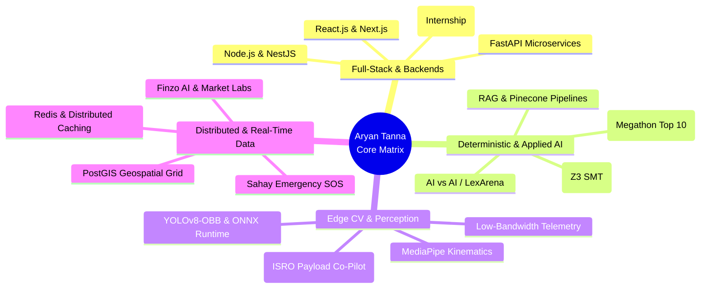

<div align="center">

```text
┌─────────────────────────────────────────────────────────────────────────────────────────────┐
│  SYS_ID: ARYAN-TANNA     ● ROLE: SOFTWARE & AI SYSTEMS ENGINEER   ● LOCATION: MUMBAI, IN    │
│  ALMA MATER: DJSCE       ● DEGREE: B.TECH CSE (DATA SCIENCE)      ● CGPA: 9.2 / 10.0        │
│  SPECIALIZATIONS: DISTRIBUTED SYSTEMS • DETERMINISTIC AI • HIGH-CONCURRENCY BACKENDS        │
└─────────────────────────────────────────────────────────────────────────────────────────────┘
```

#  ARYAN KIRIT TANNA

### Building Deterministic AI, High-Throughput Microservices & Scalable Systems

[](https://linkedin.com/in/Aryan-Tanna)
[](https://github.com/Aryan-Tanna)
[](mailto:tanna.at7@gmail.com)
[](#-academic-foundation--honors)

</div>

---

## 👨‍💻 `whoami`

I am a **Full-Stack Software and AI Systems Engineer** based in Mumbai, currently pursuing my B.Tech in Computer Science and Engineering (Data Science) at **Dwarkadas J. Sanghvi College of Engineering (DJSCE)**.

My engineering focus centers on **reliability, mathematical rigor, and high throughput**:

* **Systems & Backends:** Architecting modular, test-driven microservices across Python, Node.js, NestJS, and FastAPI, backed by relational, vector, and distributed caching layers.
* **Deterministic AI & Perception:** Grounding artificial intelligence in deterministic formal verification ($Z3$ SMT solvers) and sub-millimeter edge computer vision ($YOLO$ / $MediaPipe$).
* **Industry Experience:** Previously interned as a **Full-Stack Web Developer at Asthatic Social**, building responsive React architectures, integrating high-throughput REST APIs, and optimizing critical rendering paths.

---

## 🧭 Engineering Ecosystem & Architecture



---

## 🧰 Technical Arsenal

```text
┌───────────────────────┬────────────────────────────────────────────────────────────────────────┐
│ DOMAIN                │ TECHNOLOGIES & TOOLS                                                   │
├───────────────────────┼────────────────────────────────────────────────────────────────────────┤
│ Core Languages        │ Python, Java, C, C++, TypeScript, JavaScript, SQL, HTML5, CSS3         │
│ Backends & Frameworks │ FastAPI, NestJS, Node.js, Express.js, React.js, Next.js, Flutter       │
│ Artificial & Edge AI  │ Z3 SMT Solver, PyTorch, ONNX Runtime, YOLOv8-OBB, MediaPipe, LangChain │
│ Vector & Data Stores  │ PostgreSQL (PostGIS), MySQL, MongoDB, Redis, Pinecone, Qdrant, Firebase│
│ DevOps, Cloud & OS    │ AWS (Data, Cloud, ML), Docker, GitHub Actions, Linux / WSL2, Git       │
└───────────────────────┴────────────────────────────────────────────────────────────────────────┘
```

---

## 💼 Professional Experience

```text
Asthatic Social ──► Full-Stack Web Developer Intern [Nov 2025 – July 2026]
```
* Collaborated cross-functionally across engineering and marketing teams to architect modular, reusable UI components using **React.js** and **Node.js**.
* Integrated backend REST endpoints, optimized digital assets, and reduced asset payloads to improve page load times and Core Web Vitals.
* Conducted cross-browser compatibility testing, resolved client-side UI bugs, and maintained clean version-controlled codebases.

---

## 🏆 Academic Foundation & Honors

* **Dwarkadas J. Sanghvi College of Engineering (DJSCE)** *(2024 – 2028)*
  * *B.Tech in Computer Science and Engineering (Data Science)* &bull; **CGPA: 9.2 / 10.0**

* **Accolades & Recognition:**
  * 🏅 **Top 10 Finalist Nationwide &mdash; Megathon (IIIT Hyderabad):** Selected in the top tier nationwide for engineering an end-to-end full-stack research deconstruction engine (**Saral AI**).
  * 🎯 **19th Rank &mdash; SPIT Codebusters:** Ranked 19th among hundreds of competitive programmers in algorithmic problem solving and time-constrained optimization.
  * 📜 **Industry Certifications:** AWS Certified Data Engineering, AWS Cloud Engineering, Coursera DevOps (Packt), Machine Learning in Production, LLMOps.

---

## 🚀 Highlighted Systems

A curated selection of five systems demonstrating my work across formal logic, edge computer vision, emergency spatial networks, and quantitative financial infrastructure:

| System | Architecture & Technologies | Core Innovation & Benchmarks |
| :--- | :--- | :--- |
| [**AI vs AI (LexArena)**](https://github.com/Aryan-Tanna) | `Python` `LangGraph` `Z3 SMT` `Qdrant` `Redis` | Multi-agent courtroom engine; extracts natural claims into first-order logic via **THEMIS** to verify legal constraints ($0/34$ false rejections on honest claims; caught $7/8$ altered claims). |
| [**VYOM (BAS Co-Pilot)**](https://github.com/Aryan-Tanna) | `YOLOv8-OBB` `ONNX` `MediaPipe` `OpenCV` | Offline, CPU-only edge CV payload assistant for space-station experiments; optimized ONNX inference to $23\text{ ms/frame}$ and compressed session downlink to $486\text{ KB}$ (vs $3.6\text{ MB}$ raw video). |
| [**Finzo AI & Market Labs**](https://github.com/Aryan-Tanna) | `Flutter` `Node.js` `Pinecone` `Firebase` | Automated personal and group wealth platform with SMS transaction parsing, OCR bill splitting, and a simulated paper-trading sandbox with real-time multi-asset market data. |
| [**Sahay Disaster Grid**](https://github.com/Aryan-Tanna) | `NestJS` `PostgreSQL / PostGIS` `Socket.io` | Fault-tolerant emergency dispatch network utilizing geospatial spatial trees ($k\text{-NN}$) for sub-second victim-to-responder routing during network crises. |
| [**Saral AI**](https://github.com/Aryan-Tanna) | `FastAPI` `Next.js` `NetworkX` `LangChain` | **IIIT Hyderabad Megathon Finalist:** Deconstructs complex academic papers into hierarchical concept graphs and accessible multi-lingual audio summaries. |

---

## 📊 Telemetry & Systems Verification

```text
┌──────────────────────────────────────────────────────────────────────────────────────────────┐
│ SUBSYSTEM                   │ BENCHMARK / SPECIFICATION        │ VERIFICATION MECHANISM      │
├─────────────────────────────┼──────────────────────────────────┼─────────────────────────────┤
│ Formal Logic Verification   │ 0/34 False Rejections (Layer 1)  │ [PASS] Z3 SMT Solver        │
│ Edge Model Latency          │ 23 ms / frame on Laptop CPU      │ [PASS] ONNX Runtime Engine  │
│ Zero-Gravity Downlink Sync  │ 486 KB vs 3.6 MB Baseline        │ [PASS] SHA-256 Chained Logs │
│ Geospatial Emergency Mesh   │ Sub-second Dispatch Latency      │ [PASS] PostGIS Spatial Tree │
│ Academic Concept Extraction │ Multi-Modal Topological Graph    │ [PASS] NetworkX & NLP Graph │
│ Quantitative Sandbox        │ Real-Time Paper Trading Ticks    │ [PASS] Pinecone Vector DB   │
└─────────────────────────────┴──────────────────────────────────┴─────────────────────────────┘
```

<br />

<div align="center">
  
  
  <br /><br />
  <sub>Engineered with mathematical precision. Always building reliable backends and deterministic logic.</sub>
  <br />
  <code>printf("Hello World"); // Mumbai, India</code>
</div>
