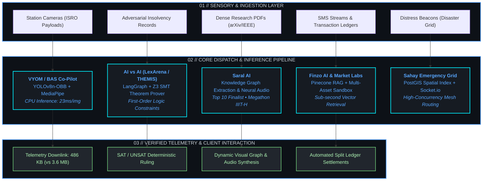

<div align="center">

```text
╔══════════════════════════════════════════════════════════════════════════════════════════════════════════════════╗
║  SYS_ID: AT-0x92       ● HOST: DJSCE-DS (CGPA: 9.2/10)     ● LOCATION: MUMBAI, IN     ● STATUS: ARMED & RUNNING  ║
║  KERNEL: LINUX / WSL2  ● ARCH: NEURO-SYMBOLIC & EDGE-CV    ● COMPILER: LLVM / GCC     ● PROTOCOL: DETERMINISTIC  ║
╚══════════════════════════════════════════════════════════════════════════════════════════════════════════════════╝
```

# ⚡ ARYAN KIRIT TANNA
### Full-Stack Software & AI Systems Engineer &bull; Neuro-Symbolic Verification &bull; Edge Microgravity Telemetry

<br />

<!-- DYNAMIC SVG TELEMETRY TYPING -->


<br /><br />

[](https://linkedin.com/in/Aryan-Tanna)
[](mailto:tanna.at7@gmail.com)
[](https://github.com/Aryan-Tanna)
[-6366F1?style=for-the-badge&logo=codeforces&logoColor=white)](https://github.com/Aryan-Tanna)

</div>

---

## 🛰️ SYSTEM ARCHITECTURE & DATAFLOW TOPOLOGY



---

## 💻 INTERACTIVE COMMAND DECK (CLICK TO EXPAND PROTOCOLS)

<div align="center">
<sub>Click any subsystem command line below to trigger operational diagnostics and system benchmarks</sub>
</div>

<br />

<details open>
<summary><b>▶ <code>$ ./inspect --subsystem=themis-lexarena --verbose</code></b></summary>
<br />

```text
[EXEC] INITIALIZING MULTI-AGENT ADVERSARIAL TRIAL BENCHMARK...
[Z3_SMT] COMPILED STATUTE CONSTRAINTS: INDIAN INSOLVENCY & BANKRUPTCY FRAMEWORK
[STATUS] NEURO-SYMBOLIC RUNTIME OPERATIONAL
```

* **System Name:** **AI vs AI - LexArena: Verified Multi-Agent Courtroom Simulation**
* **Core Stack:** `Python` &bull; `LangGraph` &bull; `Z3 SMT Solver` &bull; `Pydantic` &bull; `MongoDB` &bull; `Qdrant` &bull; `Redis`
* **Architectural Mechanics:**
  * Orchestrated a multi-agent Indian insolvency litigation engine with 2 adversarial advocate agents across an 8-turn debate protocol followed by parallel closing statements.
  * Verdicts evaluated via a 3-persona judicial panel leveraging order-swapped bias suppression checks.
  * Formatted natural-language advocate arguments into formal First-Order Logic constraints via **THEMIS verification layers** (Pydantic parsing $\rightarrow$ Statute-backed Z3 constraints $\rightarrow$ Citation checks $\rightarrow$ Counterexample-guided revision loops).
* **Empirical Validation Metrics:**
  * **Layer 1 (42 Arguments):** $0/34$ false rejections on honest claims; flagged $7/8$ altered claims.
  * **Layer 2 (Adversarial Mutations):** Detected $3/3$ adversarial mutations with $6/6$ honest first-pass approvals on development test cases.

</details>

<details>
<summary><b>▶ <code>$ ./inspect --subsystem=vyom-bas-copilot --benchmark</code></b></summary>
<br />

```text
[EXEC] BOOTING VYOM-CO-PILOT ISRO MICROGRAVITY TEST SUITE...
[NEURAL_ENGINE] LOADING ONNX RUNTIME INT8 ENGINE (CPU-ONLY)
[DOWNLINK] REDUCED BANDWIDTH: 486 KB vs 3.6 MB BASELINE VIDEO STREAM
```

* **System Name:** **VYOM: Bharatiya Antariksh Station (BAS) Experiment Co-Pilot**
* **Core Stack:** `Python` &bull; `YOLOv8-OBB` &bull; `ONNX Runtime` &bull; `OpenCV` &bull; `MediaPipe` &bull; `SHA-256 Hashing`
* **Architectural Mechanics:**
  * Zero-dependency, offline, CPU-only experiment assistant engineered for station payloads under strict uplink/downlink constraints.
  * Tracks sub-millimeter apparatus interaction via oriented bounding boxes (OBB) combined with 21-point hand skeleton kinematics via MediaPipe.
  * Enforces experimental protocol compliance with automated step-by-step voice guidance, procedural error detection, and tamper-proof SHA-256 hash-chained session logs.
* **Empirical Validation Metrics:**
  * **Detection Precision:** Trained an 8-class YOLOv8n-OBB model across 1,032 validated frames; attained $0.892\text{ mAP}_{50}$ on 205 unseen microgravity session frames.
  * **Inference Speedup:** Optimized latency to $23\text{ ms/image}$ under ONNX Runtime vs $35.6\text{ ms}$ baseline PyTorch.
  * **Safety & Reliability:** $16/16$ scripted safety violations intercepted with $0$ false alarms; operated smoothly at $15\text{--}29\text{ FPS}$ on commercial laptop CPU hardware.

</details>

<details>
<summary><b>▶ <code>$ ./inspect --subsystem=finzo-marketlabs --vector-rag</code></b></summary>
<br />

```text
[EXEC] QUERYING PINECONE VECTOR SHARD (DIMENSION: 1536)...
[FIN_MODULE] INGESTING SMS LEDGERS & OCR BILL ARTIFACTS...
[MARKET_LABS] SIMULATION RUNTIME: REAL-TIME TICK FEED ACTIVE
```

* **System Name:** **Finzo AI: Automated Financial Intelligence & Market Labs Sandbox**
* **Core Stack:** `Flutter` &bull; `Node.js` &bull; `Firebase` &bull; `Pinecone Vector DB` &bull; `PostgreSQL` &bull; `RAG`
* **Architectural Mechanics:**
  * End-to-end multi-tier personal and collective finance orchestrator handling automatic bank SMS stream ingestion, OCR bill splitting, and instant cryptographic settlement verification.
  * Integrated **Market Labs**: An algorithmic paper-trading simulation environment executing against live tick feeds with real-time portfolio analytics, volatility simulations, and automated SIP/EMI/tax calculators.
  * RAG advisory layer matches personal expenditure history against domain-specific fiscal regulation using Pinecone vector retrieval.

</details>

<details>
<summary><b>▶ <code>$ ./inspect --subsystem=saral-ai --awards=megathon</code></b></summary>
<br />

```text
[EXEC] INGESTING ACADEMIC PDF DOCUMENT (IEEE / ARXIV FORMAT)...
[NLP_EXTRACTOR] BUILDING GRAPH NODES & ONTOLOGY EDGES VIA NETWORKX...
[STATUS] MEGATHON (IIIT HYDERABAD) FINALIST RANK: TOP 10 NATIONWIDE
```

* **System Name:** **Saral AI: Multi-Modal Academic Simplification & Knowledge Synthesis**
* **Core Stack:** `Python` &bull; `FastAPI` &bull; `Next.js` &bull; `NetworkX` &bull; `LangChain` &bull; `Neural TTS`
* **Architectural Mechanics:**
  * Deconstructs dense multi-column research literature into plain-language conceptual hierarchies and dynamic interactive concept graphs.
  * Synthesizes mathematical proofs and algorithmic flow into multi-dialect neural voice output for auditory research consumption.
  * **Recognition:** Awarded **Top 10 Finalist** nationwide out of hundreds of engineering teams at **Megathon (IIIT Hyderabad)**.

</details>

<details>
<summary><b>▶ <code>$ ./inspect --subsystem=sahay --grid-dispatch</code></b></summary>
<br />

```text
[EXEC] SPATIAL INDEXING ACTIVE: POSTGIS R-TREE CLUSTER LOADED...
[BROADCAST] LOW-LATENCY WEBSOCKET DISPATCH READY...
```

* **System Name:** **Sahay: Real-Time High-Concurrency Disaster Relief Mesh**
* **Core Stack:** `Flutter` &bull; `NestJS` &bull; `PostgreSQL / PostGIS` &bull; `Socket.io` &bull; `Redis Streams`
* **Architectural Mechanics:**
  * High-availability disaster response framework engineered for intermittent network topologies with local offline cache synchronization.
  * Sub-second spatial pairing of SOS broadcasts to the nearest relief vehicles and supply hubs via PostGIS nearest-neighbor query trees ($k\text{-NN}$).

</details>

---

## 📊 VERIFIED HARDWARE & SOFTWARE BENCHMARKS

```text
┌─────────────────────────────────┬───────────────────────────────┬──────────────────────────────────────┐
│ SUBSYSTEM METRIC                │ RECORDED VALUE                │ ARCHITECTURAL ADVANTAGE              │
├─────────────────────────────────┼───────────────────────────────┼──────────────────────────────────────┤ 
│ VYOM Edge Inference Latency     │ 23.0 ms / image (ONNX)        │ 35.4% faster than native PyTorch     │
│ VYOM Telemetry Packet Footprint │ 486 KB compressed             │ 86.5% reduction vs raw video (3.6 MB)│
│ THEMIS Layer 1 Honest Claims    │ 0 False Rejections (0/34)     │ Zero-Hallucination Formal Logic Proof│
│ THEMIS Altered Claim Detection  │ 87.5% Sensitivity (7/8)       │ Deterministic SAT/UNSAT Resolution   │
│ Megathon (IIIT Hyderabad)       │ Top 10 Finalist               │ Full-Stack & Applied ML Product      │
└─────────────────────────────────┴───────────────────────────────┴──────────────────────────────────────┘
```

---

## 🧰 TECHNICAL ARSENAL

<div align="center">

```text
   LANGUAGES       CORE BACKENDS         AI, CV & LOGIC         CLOUD & DATA
  ───────────     ───────────────       ────────────────       ──────────────
  • Python        • FastAPI             • Z3 SMT Solver        • Docker
  • C / C++       • Node.js / Express   • PyTorch / ONNX       • AWS (Cloud/Data)
  • Java          • NestJS              • YOLOv8-OBB           • Linux / WSL2
  • TypeScript    • Next.js / React     • OpenCV / MediaPipe   • PostgreSQL / PostGIS
  • SQL           • Flutter             • Pinecone / Qdrant    • Redis / MongoDB
```

</div>

<p align="center">
  
</p>

---

## 📈 GITHUB METRICS & TELEMETRY STREAM

<div align="center">
  
  
</div>

<br />

<div align="center">
  
</div>

---

<div align="center">
  <code>OPERATOR COMM-LINK: <a href="mailto:tanna.at7@gmail.com">tanna.at7@gmail.com</a> | PHONE: +91-7666999887 | LOCATION: MUMBAI, INDIA</code>
  <br /><br />
  <sub>Architected with deterministic rigor. No hallucinated claims; proven by code and mathematical constraints.</sub>
</div>
