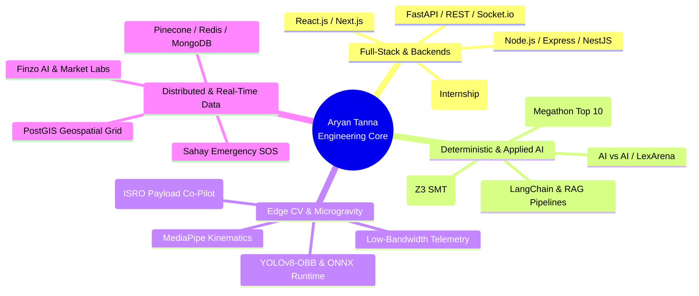

<div align="center">

```text
┌──────────────────────────────────────────────────────────────────────────────────────────────────┐
│  SYS_ID: ARYAN-TANNA     ● ROLE: SOFTWARE & AI SYSTEMS ENGINEER   ● LOCATION: MUMBAI, IN         │
│  ALMA MATER: DJSCE       ● DEGREE: B.TECH CSE (DATA SCIENCE)      ● CGPA: 9.2 / 10.0             │
│  SPECIALIZATIONS: FULL-STACK ARCHITECTURE • NEURO-SYMBOLIC AI • HIGH-CONCURRENCY BACKENDS        │
└──────────────────────────────────────────────────────────────────────────────────────────────────┘
```

#  ARYAN KIRIT TANNA

### Building Deterministic AI, High-Throughput Microservices & Scalable Systems

[](https://linkedin.com/in/Aryan-Tanna)
[](https://github.com/Aryan-Tanna)
[](mailto:tanna.at7@gmail.com)
[](https://maps.google.com/?q=Mumbai,+India)

<br />


</div>

---

## 👨‍💻 `whoami`

I am a **Full-Stack Software and AI Systems Engineer** based in Mumbai, currently pursuing my B.Tech in Computer Science and Engineering (Data Science) at **Dwarkadas J. Sanghvi College of Engineering (DJSCE)** with a **9.2 CGPA**.

My engineering philosophy centers on **predictability, clean abstractions, and high throughput**:
* **Systems & Backends:** Architecting modular, test-driven microservices across Python, Node.js, NestJS, and FastAPI, backed by relational and vector databases.
* **Deterministic AI & Perception:** Moving beyond generic probabilistic LLM calls into neuro-symbolic verification (Z3 SMT solvers) and sub-millimeter edge vision (YOLO / MediaPipe).
* **Algorithmic Foundations:** Active competitive programming problem solver (ranked **19th nationwide** at SPIT Codebusters).
* **Industry Experience:** Previously interned as a **Full-Stack Web Developer at Asthatic Social**, engineering responsive React interfaces, integrating high-throughput REST APIs, and optimizing critical rendering paths.

---

## 🛰️ Engineering Ecosystem & Domain Matrix



---

## 🗂️ Interactive Dossier

<details open>
<summary><b>💼 Professional Experience & Industry Impact</b></summary>
<br />

* **Full-Stack Web Developer Intern &bull; Asthatic Social** *(Nov 2025 – July 2026)*
  * Collaborated cross-functionally across product and engineering to architect modular, reusable UI components using **React.js** and **Node.js**.
  * Engineered robust backend REST API endpoints, optimized digital assets, and trimmed asset payloads to improve client-side page load times and Core Web Vitals.
  * Spearheaded cross-browser compatibility debugging and maintained clean, Git-versioned codebases under agile development cycles.

</details>

<details>
<summary><b>🎓 Academic Foundation & Honors</b></summary>
<br />

* **Dwarkadas J. Sanghvi College of Engineering (DJSCE)** *(2024 – 2028)*
  * *B.Tech in Computer Science and Engineering (Data Science)* &bull; **CGPA: 9.2 / 10.0**
  * Core Coursework: Data Structures & Algorithms, Object-Oriented Programming, Database Management Systems, Linear Algebra, Probability & Statistics, Distributed Computing.
* **Pace Science Junior College** *(2022 – 2024)*
  * Higher Secondary Certificate (HSC) &bull; **81%**
* **Key Honors & Badges:**
  * 🏆 **Top 10 Finalist Nationwide &mdash; Megathon (IIIT Hyderabad):** Built an end-to-end full-stack AI research simplification engine (**Saral AI**).
  * 🥇 **19th Rank &mdash; SPIT Codebusters:** Competed against hundreds of algorithmic programmers in speed, mathematical parsing, and memory optimization.
  * 📜 **Industry Certifications:** AWS Data Engineering, AWS Cloud Engineering, Coursera DevOps (Packt), Machine Learning in Production, LLMOps.

</details>

<details open>
<summary><b>🚀 Highlighted Systems & Proof-of-Concepts</b></summary>
<br />

A curated selection of systems demonstrating my work across formal logic, edge vision, geospatial networks, and quantitative finance:

| System | Domain & Key Technologies | Core Innovation / Benchmark |
| :--- | :--- | :--- |
| **[AI vs AI (LexArena)](https://github.com/Aryan-Tanna)** | `Python` `LangGraph` `Z3 SMT` `Qdrant` `Redis` | Multi-agent courtroom engine; converts natural arguments into first-order logic via **THEMIS** to verify legal claims ($0/34$ false rejections on honest claims). |
| **[VYOM (BAS Co-Pilot)](https://github.com/Aryan-Tanna)** | `YOLOv8-OBB` `ONNX` `MediaPipe` `OpenCV` | Real-time edge CV payload co-pilot for space-station experiments; optimized CPU inference to **$23\text{ ms/image}$** and compressed telemetry downlinks by **$86\%$**. |
| **[Finzo AI & Market Labs](https://github.com/Aryan-Tanna)** | `Flutter` `Node.js` `Pinecone` `Firebase` | Automated personal wealth platform with SMS transaction parsing, OCR bill splitting, and a simulated real-time tick-feed paper trading sandbox. |
| **[Sahay Disaster Grid](https://github.com/Aryan-Tanna)** | `NestJS` `PostgreSQL / PostGIS` `Socket.io` | Fault-tolerant emergency dispatch system using spatial trees ($k\text{-NN}$) for sub-second victim-to-responder routing during crisis surges. |
| **[Saral AI](https://github.com/Aryan-Tanna)** | `FastAPI` `Next.js` `NetworkX` `LangChain` | **IIIT Hyderabad Megathon Finalist:** Translates dense research literature into interactive topological concept graphs and multi-lingual audio synthesis. |

</details>

---

## 🧰 Technical Arsenal

```text
┌───────────────────────┬────────────────────────────────────────────────────────────────────────┐
│ DOMAIN                │ TECHNOLOGIES & TOOLS                                                   │
├───────────────────────┼────────────────────────────────────────────────────────────────────────┤
│ Core Languages        │ Python, Java, C, C++, TypeScript, JavaScript, SQL, HTML5, CSS3         │
│ Frameworks & Backend  │ FastAPI, NestJS, Node.js, Express.js, React.js, Next.js, Flutter       │
│ Artificial & Edge AI  │ Z3 SMT Solver, PyTorch, ONNX, YOLOv8-OBB, MediaPipe, OpenCV, LangChain │
│ Vector & Databases    │ PostgreSQL (PostGIS), MySQL, MongoDB, Redis, Pinecone, Qdrant, Firebase│
│ DevOps, Cloud & OS    │ AWS (Cloud & Data), Docker, GitHub Actions, Linux / WSL2, Git          │
└───────────────────────┴────────────────────────────────────────────────────────────────────────┘
```

---

## 📊 Live Telemetry & GitHub Metrics

<div align="center">
  
  
</div>

<div align="center">
  
</div>

---

<div align="center">
  <sub>Engineered with precision. Available for software engineering and AI systems roles.</sub>
  <br />
  <sub><code>printf("Hello World"); // Mumbai, India</code></sub>
</div>
